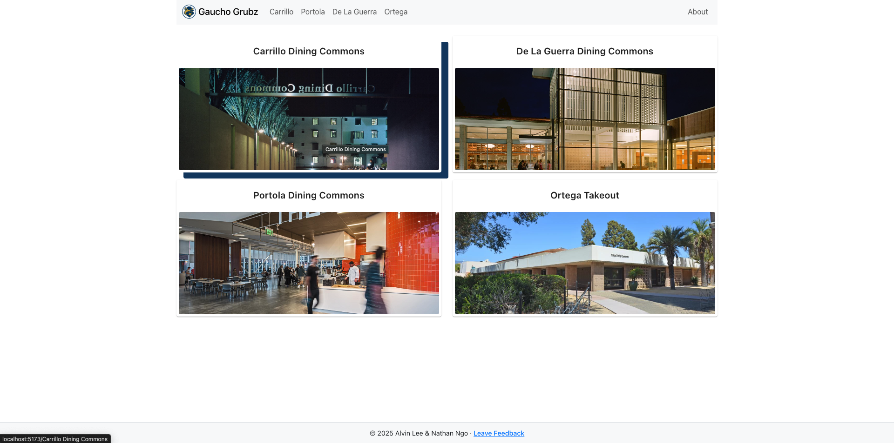
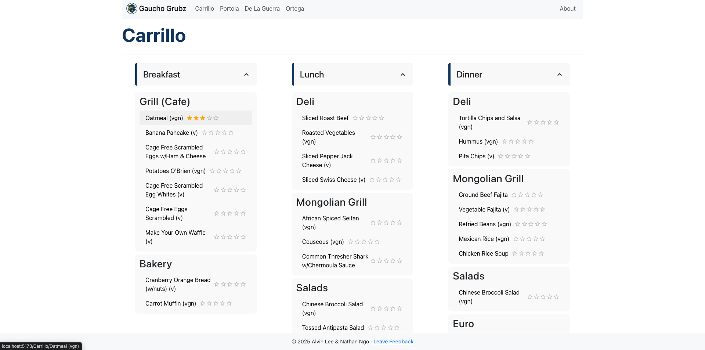
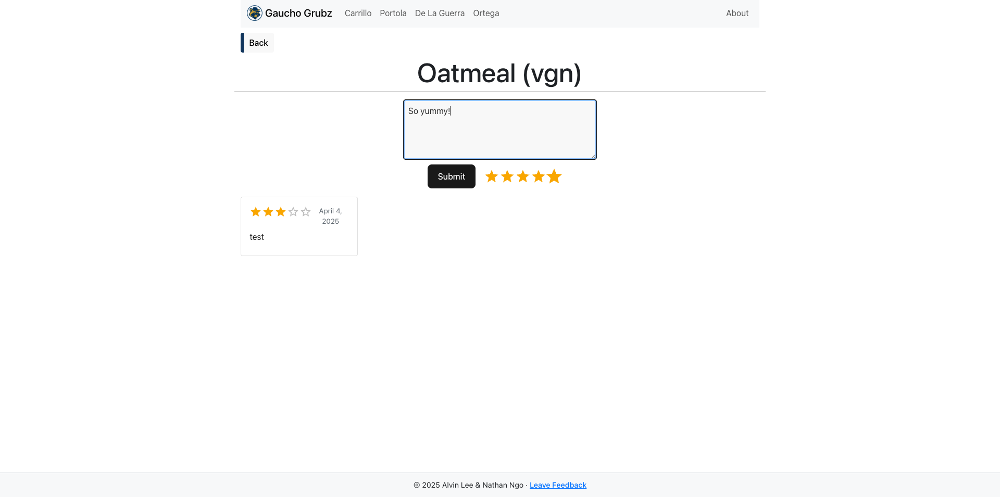
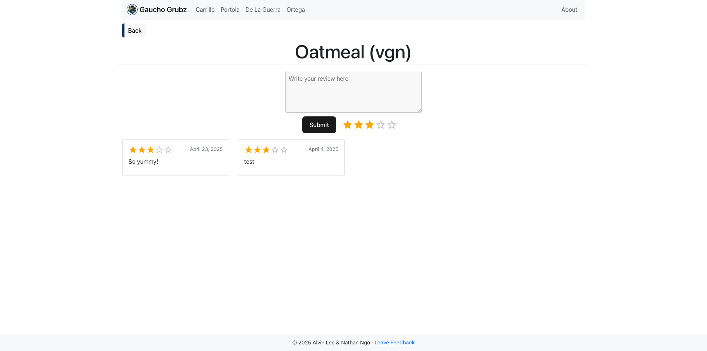

<p align="center">
  
</p>

<h1 align="center">GauchoGrub</h1>

Gaucho Grub is a full-stack web application that allows UCSB students to view real-time dining hall menus and submit reviews for specific menu items. Built by Nathan Ngo and Alvin Lee as a collaborative project at UCSB to enhance student dining experiences by combining live data with crowd-sourced feedback.

## [Live Website Here](https://gauchogrub.vercel.app/)

## Features

- **Daily Menus** - View current menus by dining hall pulled from UCSB Dining API (Carrillo, Portola, Ortega, etc.)
- **Give Feedback** - Submit reviews and ratings for specific dishes
- **Read Feedback** - View average ratings and user feedback per food item
- **Smart UX** – Fast loading indicators, mobile-first layout, and one-click interactions
- **Profanity Filter** – Automatically blocks offensive content client-side
- **Average Ratings** – See what dishes students actually enjoy
- **Menu Caching** – Daily UCSB Dining data is cached in PostgreSQL for fast access

## Technologies Used

**Frontend**:
- React (JSX), React Router, Axios, React Bootstrap, Material UI
- Vite for fast builds and local development

**Backend**:
- Flask (Python), psycopg2, Requests
- Scheduled data fetch via `update_database.py`

**Database**:
- Supabase (PostgreSQL)
- Profanity-checked reviews with brief duplicate-submission suppression

**API**:
- UCSB Dining API

**Deployment**:
- Frontend and backend: Vercel (separate projects rooted at `client/` and `server/`)
- Database: Supabase PostgreSQL
- Automation: GitHub Actions (runs nightly data pulls)

**Package Managers**:
- pip (Python)
- pnpm for the Vercel frontend deployment; npm for local development and GitHub Actions

**DevOps**:
- GitHub Actions
- Docker for local backend development
- .env files

## Database Schema

The PostgreSQL database uses three main tables:

### `menu_items`
Stores metadata for each unique menu item across dining halls and meals.

| Column      | Type    | Description                             |
|-------------|---------|-----------------------------------------|
| `id`        | int4    | Primary key                             |
| `name`      | text    | Name of the menu item                   |
| `dining_hall` | text  | Name of the dining hall (e.g. Carrillo) |
| `meal`      | text    | Meal type (Breakfast, Lunch, etc.)      |
| `station`   | text    | The food station serving the item       |
| `avg_rating`| float4  | Cached average rating for quick reads   |

---

### `reviews`
Stores all user-submitted reviews tied to a specific menu item.

| Column         | Type     | Description                                      |
|----------------|----------|--------------------------------------------------|
| `id`           | int4     | Primary key                                      |
| `menu_item_id` | int4     | Foreign key referencing `menu_items(id)`         |
| `rating`       | float4   | User rating (supports half-stars e.g., 4.5)      |
| `comment`      | text     | User review text (max 300 characters)            |
| `created_at`   | timestamp| Timestamp of when the review was created         |

---

### `daily_menu`
Stores pre-fetched UCSB Dining API data to reduce request latency.

| Column         | Type       | Description                                 |
|----------------|------------|---------------------------------------------|
| `date`         | date       | Primary key (one row per day)               |
| `data`         | text       | Full JSON blob of menu data for the day     |
| `last_updated` | timestamp | Timestamp of last successful refresh        |

## API Routes

| Method | Route | Description |
|--------|-------|-------------|
| GET | `/` | Returns current menu data for all dining halls |
| POST | `/<dining_hall>/<item_name>` | Submits a review for a menu item |
| GET | `/<dining_hall>/<item_name>` | Returns all reviews + avg rating for an item |

## Deployment & Automation

| Component | Hosted on | Role |
|-----------|-----------|------|
| React frontend | Vercel (`client/` project root) | Serves the website and calls the Flask API using `VITE_API_BASE_URL`. |
| Flask backend | Vercel (`server/` project root) | Serves menus, reviews, and ratings. Connects to Supabase using `DATABASE_URL`. |
| PostgreSQL database | Supabase | Stores menu items, reviews, ratings, and the daily menu cache. |
| Menu refresh | GitHub Actions | Runs `server/update_database.py` daily at 10:00 UTC to fetch UCSB Dining data and update Supabase. |

Pull requests and pushes to `main` run backend tests, frontend tests, lint, and build in GitHub Actions. Vercel handles frontend and backend deployments separately from this CI workflow.

The frontend build needs `VITE_API_BASE_URL` set to the Vercel backend URL. The backend needs `DATABASE_URL` for Supabase PostgreSQL and `API_KEY` for the UCSB Dining API. The scheduled refresh workflow reads `DATABASE_URL` and `API_KEY` from GitHub Actions secrets. Keep their values out of the repository.

Before first deployment to a new database, run `python server/database_setup.py` with `DATABASE_URL` set. Then run `python server/update_database.py` with both `DATABASE_URL` and `API_KEY` set to populate the first menu. Schema creation is a manual bootstrap step; the nightly refresh only inserts data. A failed or empty UCSB response now leaves the previous daily snapshot intact and causes the scheduled job to fail visibly.

Reviews are anonymous. The server suppresses identical comments on the same item for 10 seconds; there is no user identity or one-review-per-user enforcement. For a future public launch, consider account-backed rate limits and moderation.

## Local Development with Docker

The Flask backend is containerized using Docker to provide a consistent development environment without requiring a local Python installation or manual dependency setup.

### Prerequisites

- [Docker Desktop](https://www.docker.com/products/docker-desktop/)
- A PostgreSQL database (the application currently uses Supabase)
- Valid `DATABASE_URL` and `API_KEY` environment variables

### Build the Docker Image

From the project root, run:

```bash
docker build -t gauchogrub-backend ./server
```

This builds an image using Python 3.13 and installs the backend dependencies from `server/requirements.txt`.

### Run the Backend

Create a `server/.env.prod` file containing the required environment variables:

```env
DATABASE_URL=your_postgresql_connection_string
API_KEY=your_ucsb_dining_api_key
```

Start the container:

```bash
docker run -d \
  --rm \
  -p 8080:8080 \
  --env-file server/.env.prod \
  --name gauchogrub-api \
  gauchogrub-backend
```

The Flask API runs through Gunicorn and is accessible at `http://localhost:8080`.

### Verify the API

Check the health endpoint:

```bash
curl http://localhost:8080/health
```

Expected response:

```text
OK
```

Fetch the dining hall menus:

```bash
curl http://localhost:8080/
```

The endpoint returns JSON containing menus for the UCSB dining halls.

### Manage the Container

View running containers:

```bash
docker ps
```

View application logs:

```bash
docker logs gauchogrub-api
```

Stop the backend:

```bash
docker stop gauchogrub-api
```

The container is automatically removed after stopping because it was started with `--rm`.

### Architecture

- **Frontend:** React + Vite, hosted on Vercel
- **Backend:** Flask + Gunicorn, hosted on Vercel and containerized for local development
- **Database:** Supabase PostgreSQL
- **CI/CD:** GitHub Actions for automated testing
- **Deployment:** Vercel projects rooted at `client/` and `server/`

Docker provides reproducible local backend execution. Vercel deploys the production frontend and backend as separate projects.

## Tests

Run the backend route and updater tests:

```sh
python -m pip install -r server/requirements.txt
python -m unittest discover -s server/tests -v
```

Set `TEST_DATABASE_URL` to a PostgreSQL test database URL to also run the integration tests. They create and remove their own schema. GitHub Actions provides a temporary PostgreSQL service for every CI run.

Run the frontend utility and React interaction tests from `client/`:

```sh
npm ci
npm test
npm run lint
npm run build
```

## Screenshots

### Home Page – Dining Hall Selection


### Menu View – Food by Meal and Station


### Review Submission – Leave Feedback on Items


### Review Display – See What Others Said


## Contributors

- [Alvin Lee](https://github.com/nitron532)
- [Nathan Ngo](https://github.com/ngostream)
